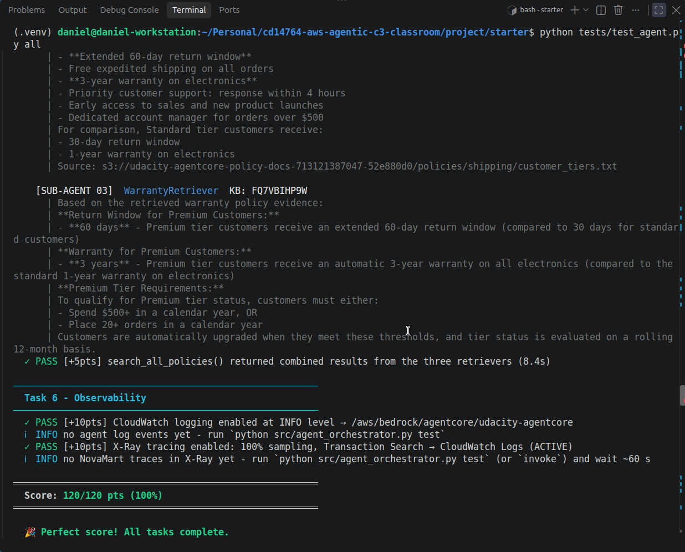
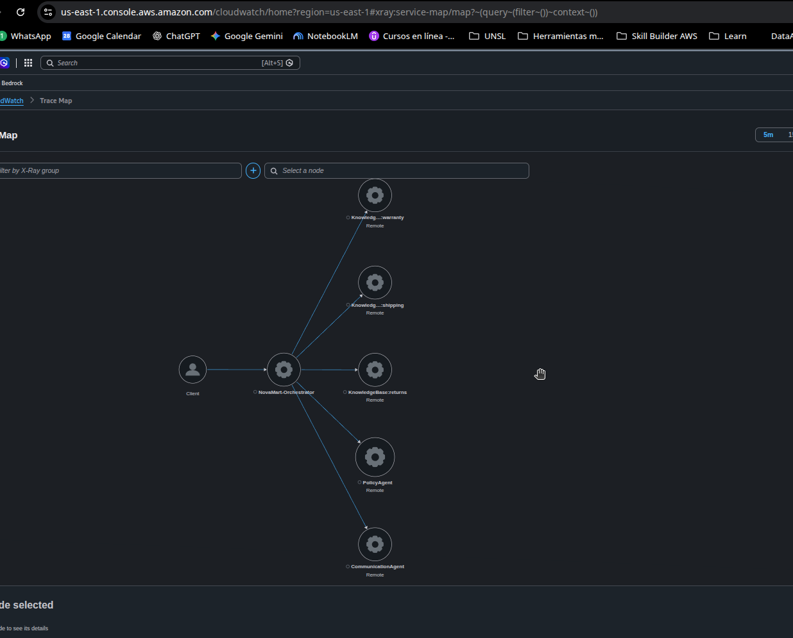

# NovaMart Capstone Submission

## Automated test results

The final automated test score is **120/120 (100%)**.

## End-to-end X-Ray evidence

The AWS X-Ray Trace Map shows the NovaMart end-to-end agent chain.

## Deployed resources and observability

- AgentCore Runtime successfully deployed.
- Bedrock Guardrail configured.
- AgentCore Memory configured.
- Three Bedrock Knowledge Bases created and synchronized.
- CloudWatch and X-Ray observability enabled.
